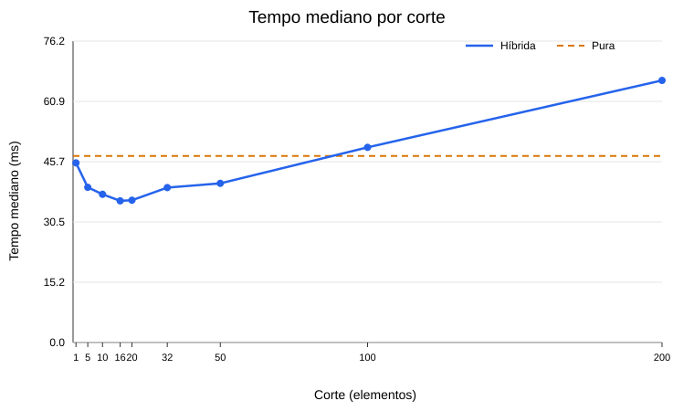

# Ordenação híbrida: Quick Sort com Insertion Sort

**Autora:** Gabriela

## Objetivo

Implementar Quick Sort com pivô aleatório e partição em menores, iguais e maiores. Na versão híbrida, trechos com menos de `corte` elementos são ordenados por Insertion Sort. O experimento compara nove valores de corte com a Quick Sort pura.

## Método

Foram usados 20.000 inteiros pseudoaleatórios de 0 a 999.999, gerados com semente fixa. Cada configuração ordenou uma cópia da mesma lista por sete vezes. Em cada repetição, a Quick Sort pura e todas as versões híbridas receberam a mesma semente de pivôs. A ordem das configurações foi alternada. O tempo foi medido com `time.perf_counter()`; copiar os dados e verificar o resultado ficaram fora da medição. A tabela apresenta a **mediana** das sete medidas. Os tempos variam conforme a máquina e sua carga.

## Resultados

| Corte | Tempo mediano (ms) |
|---:|---:|
| 1 | 45,3937 |
| 5 | 39,2207 |
| 10 | 37,4528 |
| **16** | **35,7994** |
| 20 | 35,9582 |
| 32 | 39,1473 |
| 50 | 40,2229 |
| 100 | 49,3195 |
| 200 | 66,2369 |
| Quick Sort pura | 47,1453 |

O melhor resultado desta execução foi **corte 16**, com **35,7994 ms**. A Quick Sort pura levou **47,1453 ms**. A diferença foi **11,3459 ms**, ou **24,07%** do tempo da versão pura: `(47,1453 - 35,7994) / 47,1453 × 100`.

Com cortes grandes, a inserção recebe trechos maiores. Seu custo quadrático passa a pesar: aqui, os cortes 100 e 200 ficaram mais lentos que a Quick Sort pura. O melhor corte não é uma constante universal; depende dos dados, da implementação e do computador.

## Por que corte = 1 equivale à Quick Sort pura?

A inserção só é chamada se o tamanho do trecho for **menor** que `corte`. Com `corte = 1`, nenhum trecho com dois ou mais elementos atende a essa condição. A função `quicksort_pura` executa o mesmo algoritmo com `corte=1`; o teste confirma que a inserção não é chamada. Os tempos de 45,3937 ms e 47,1453 ms são próximos, com variação normal de medição.

## Reprodução

Execute `py testes.py` e `py experimento.py`. O segundo comando atualiza `resultados_benchmark.csv` e `grafico_cortes.svg`. Se você repetir o experimento, substitua os valores desta tabela, o melhor corte e o ganho pelos novos resultados antes de entregar.
